# Old Pochmann 3BLD

Aprende a resolver el cubo de Rubik **con los ojos cerrados** (3BLD) con el método Old Pochmann y letras Speffz. Una app web instalable que funciona sin conexión, con tutorial interactivo, entrenador de setups, cronómetro de competición, retos con amigos, overlay para directos y soporte para **cubos inteligentes GAN** por Bluetooth.

**[old-pochmann-3bld.vercel.app](https://old-pochmann-3bld.vercel.app)** · [probarla con un cubo virtual](https://old-pochmann-3bld.vercel.app/?cubo=virtual#crono)

Y para speedcubing, en el mismo sitio: **[Fridrich reducido](https://old-pochmann-3bld.vercel.app/fridrich)**, CFOP en 2 pasos con los algoritmos de J Perm, tiempos por fase y los casos reconocidos por el cubo inteligente ([más abajo](#fridrich-reducido)). Y para quien empieza de cero: **[Aprende a resolver el cubo](https://old-pochmann-3bld.vercel.app/principiante)**, el método de principiantes en 7 pasos, con dibujos y la ayuda en directo del cubo inteligente ([más abajo](#aprende-a-resolver-el-cubo)).

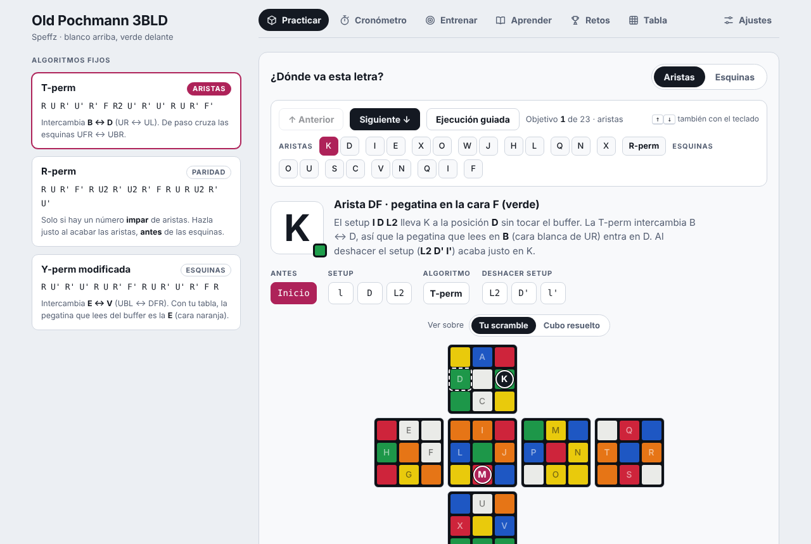

<table>
<tr>
<td width="50%">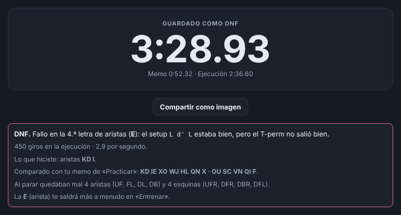</td>
<td width="50%">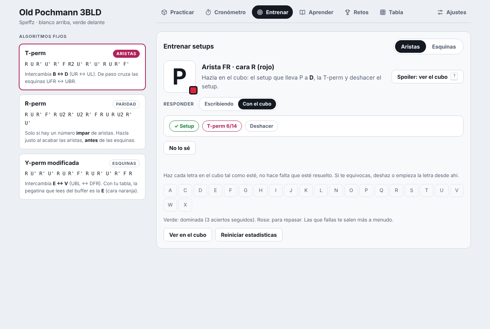</td>
</tr>
<tr>
<td>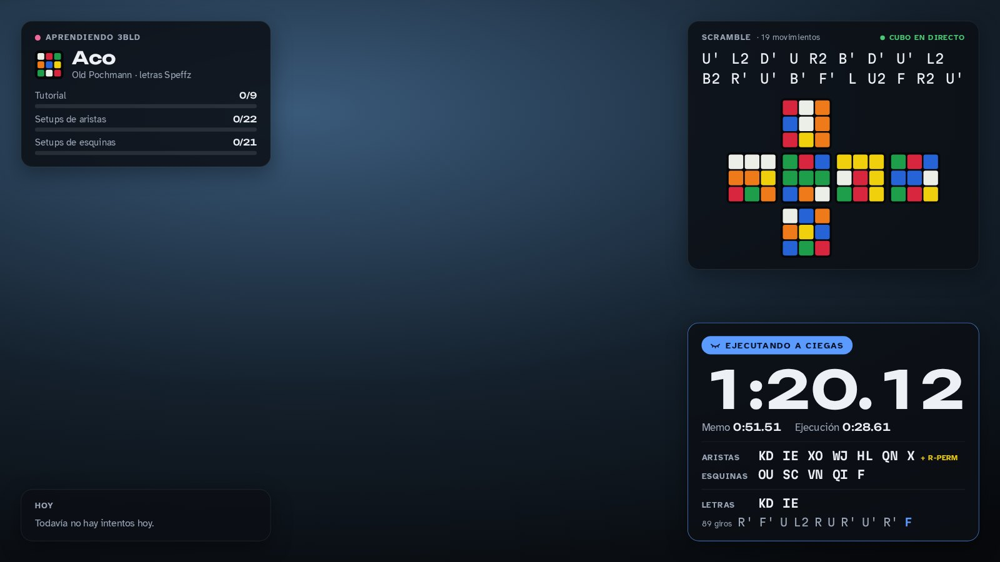</td>
<td align="center">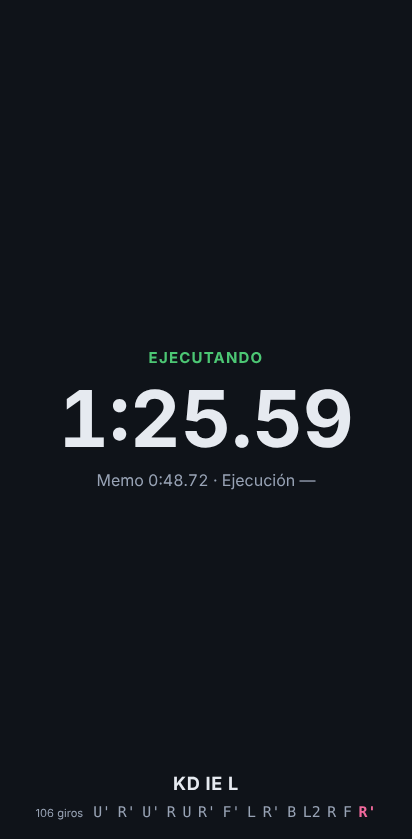</td>
</tr>
</table>

## Índice

- [Qué hace](#qué-hace)
- [Cubo inteligente](#cubo-inteligente)
- [Overlay para directos](#overlay-para-directos)
- [Fridrich reducido](#fridrich-reducido)
- [Aprende a resolver el cubo](#aprende-a-resolver-el-cubo)
- [El método](#el-método)
- [Atajos de teclado](#atajos-de-teclado)
- [Arquitectura](#arquitectura)
- [API](#api)
- [Privacidad](#privacidad)
- [Desarrollo](#desarrollo)
- [Créditos y licencias](#créditos-y-licencias)

## Qué hace

| Sección | Para qué |
|:--|:--|
| **Practicar** | Pegas o generas un scramble y escribes tu memo. Ves cada letra en el cubo: dónde está la pegatina, el setup paso a paso y cómo queda tras la T-perm o la Y-perm. «Comprobar memo» dice si el memo resuelve el cubo y, si no, la primera letra que está mal y por qué; «Generar memo recomendado» calcula el memo con menos movimientos. La **ejecución guiada** te lleva giro a giro por toda la resolución. |
| **Cronómetro** | Memo y ejecución por separado, historial con filtros (todos, resueltos, DNF), estadísticas y compartir un intento como imagen. El **modo competición** deja solo el reloj a pantalla completa, con toda la pantalla como botón y la pantalla siempre encendida. |
| **Entrenar** | Te pregunta letras al azar y respondes el setup escribiéndolo o haciéndolo en el cubo inteligente. Las que fallas, y las que fallaste en tus intentos cronometrados, salen más a menudo hasta que las aciertes tres veces seguidas. Con spoiler del cubo (tecla `?`). |
| **Aprender** | Tutorial interactivo de 9 lecciones: orientación y letras, buffer y T-perm, setups, hacer el memo, cambio de ciclo, aristas volteadas, paridad, esquinas y tu primera resolución. |
| **Retos** | Mandas un scramble a tus amigos con un enlace corto (`/r/abc12345`) que en Discord, WhatsApp o Telegram se ve con una imagen del cubo, quién te reta y el mejor tiempo. Cada uno sube su resultado y se comparan. |
| **Tabla** | Todos los setups de aristas y esquinas de un vistazo; toca una letra para verla en el cubo. |
| **Ajustes** | Tu nombre, tema claro u oscuro, sonido y vibración del cubo inteligente, el overlay para directos y la **sincronización** entre dispositivos con un código de 16 caracteres. |

Además:

- **Instalable y sin conexión.** Es una PWA: en el móvil se añade a la pantalla de inicio (en iPhone, Compartir → Añadir a pantalla de inicio) y funciona sin internet, incluido el generador de scrambles. Solo los retos y la sincronización necesitan red.
- **Scrambles como los de la WCA.** Estado aleatorio resuelto con el algoritmo de dos fases de Kociemba ([cubejs](https://github.com/ldez/cubejs)) en un Web Worker. También solo aristas o solo esquinas.
- **Siempre al día.** Cuando hay una versión nueva, la app lo avisa, pero nunca en mitad de un intento.

## Cubo inteligente

Con un cubo GAN conectado por Bluetooth, la app sabe en todo momento cómo está tu cubo.

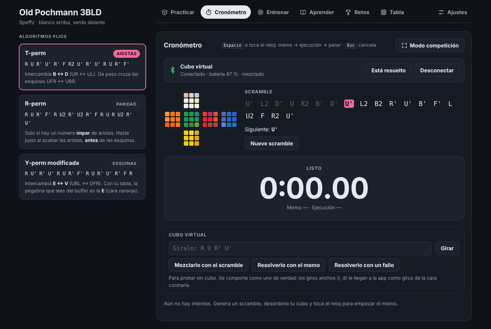

- **Sigue el scramble** giro a giro: marca los hechos, resalta el siguiente, entiende los medios giros hechos en cualquier sentido y, si te equivocas, te dice qué deshacer. Si lo has mezclado a tu manera, «Usar mi cubo como scramble» lo convierte en el scramble de la app.
- **Cronometra solo.** El primer giro termina el memo y empieza la ejecución; cuando el cubo queda resuelto, el crono se para, lo guarda como resuelto, suena y (en el móvil) vibra. Si lo paras tú sin resolver, el cubo lo comprueba y te propone DNF.
- **Explica los DNF.** Reconstruye las letras que hiciste a partir de los estados por los que pasó el cubo y dice en qué letra falló y en qué parte: el setup, el algoritmo o al deshacer el setup. Si escribes tu memo en Practicar, distingue además si hiciste otra letra o si el memo ya estaba mal. Esa letra pasa a salir más en Entrenar.
- **Entrena en el cubo.** En Entrenar haces cada letra en el cubo, desde como esté; la app marca setup, algoritmo y deshacer, avisa del primer giro equivocado y mide cuánto tardas en pensar y en ejecutar.
- **Practica a tu ritmo.** En Practicar, con tu memo escrito, la letra y el paso que ves avanzan solos según giras: sin reloj, mirando el memo y el dibujo, con aviso del giro equivocado y de qué deshacer.
- **Guía la resolución.** Con la ejecución guiada abierta, los pasos avanzan solos según giras y se colocan donde esté tu cubo.
- **Lee el cubo.** Mezcla a mano como quieras y «Leer el cubo» saca el scramble (tus propios giros, si la app los vio; si no, uno calculado) para hacer el memo y comprobarlo.
- **En directo.** El modo competición muestra abajo los giros y cada letra en cuanto la completas, y el overlay enseña el cubo real moviéndose.

### Compatibilidad

Usa [Web Bluetooth](https://developer.mozilla.org/docs/Web/API/Web_Bluetooth_API), que no está en todos los navegadores:

| Navegador | ¿Funciona? |
|:--|:--|
| Chrome o Edge en Windows, macOS, ChromeOS y Android | Sí |
| Chrome en Linux | Con `chrome://flags/#enable-experimental-web-platform-features` activado y BlueZ funcionando |
| Firefox, Zen y derivados | Con la extensión [WebBT](https://addons.mozilla.org/firefox/addon/webbt/) y su programa [WebBT Server](https://github.com/stevennyman/webbt/releases/latest) (experimental) |
| Safari y cualquier navegador de iPhone o iPad | No. En iPhone solo con la app [Bluefy](https://apps.apple.com/app/id1492822055) |

Cubos compatibles (los de [gan-web-bluetooth](https://github.com/afedotov/gan-web-bluetooth)): GAN356 i 3, GAN356 i Carry, i Carry S e i Carry 2, GAN12 ui (FreePlay y Maglev), GAN14 ui FreePlay, GAN Mini ui FreePlay, Monster Go 3Ai y MoYu AI 2023.

### La primera vez

1. Cronómetro → **Conectar cubo** y elige tu cubo en la ventana del navegador (si no aparece, gíralo un poco para despertarlo).
2. Los datos del cubo van cifrados con su dirección MAC. Si el navegador no la da, la app la pide una sola vez y explica dónde verla (`chrome://bluetooth-internals`). Para que salga sola, activa `chrome://flags/#enable-experimental-web-platform-features` (en Edge, `edge://flags/…`).
3. Si el cubo y la app no coinciden (por ejemplo, lo giraste estando apagado), resuélvelo y pulsa **Está resuelto**.

Para probar todo esto sin cubo, abre la app con [`?cubo=virtual`](https://old-pochmann-3bld.vercel.app/?cubo=virtual#crono): aparece un cubo virtual que se comporta como uno de verdad, con botones para mezclarlo y resolverlo (bien o con un fallo).

### Cómo funciona por dentro

- **El marco del núcleo.** Un cubo inteligente solo siente sus seis caras girando alrededor de un núcleo fijo: para él, un `l` es un `R` con el cubo rotado, y un `M` son dos giros de cara. `cube.js` compara siempre los estados en ese marco, con los centros en su sitio (`norm()` busca la rotación de las 24 que los devuelve a casa), así que da igual cómo sujetes el cubo o qué giros anchos uses.
- **Estados, no movimientos.** El modelo del cubo es una permutación de 54 pegatinas (`core.js`). Para seguir una secuencia (el scramble, una letra en Entrenar, el memo en Practicar, la ejecución guiada) se precalculan los estados tras cada giro, y los intermedios de los medios giros en los dos sentidos; tu cubo está en el paso cuyo estado coincide. Si no coincide con ninguno, lo que tienes que deshacer se nombra como tienes el cubo en la mano en ese momento.
- **Reconstruir un intento.** Tras cada letra bien hecha (setup + algoritmo + deshacer), el cubo debe estar exactamente donde lo deja esa letra. El análisis busca, entre las 44 letras posibles, la primera cuyo estado aparece en el recorrido del cubo, y repite desde ahí. Donde ya no encuentra ninguna está el fallo; dentro de esa letra mira si se llegó al estado tras el setup y tras el algoritmo.
- **El cubo manda.** Al empezar cada memo y al parar, la app le pide al cubo su estado completo, por si se perdió algún giro por el camino.

## Overlay para directos


`overlay.html` es una página transparente de 1920×1080 pensada como fuente de navegador en OBS. Muestra quién eres y tu progreso, el scramble con su cubo, las estadísticas del día y el cronómetro con el memo (si lo escribiste y es correcto). Con el cubo inteligente, además, el cubo en directo, los giros y las letras.

La app le manda el estado por dos caminos:

1. **OBS (recomendado).** Ajustes → Overlay para stream → **Conectar con OBS**. La app habla con [obs-websocket](https://github.com/obsproject/obs-websocket) 5 (Herramientas → Ajustes del servidor WebSocket en OBS; puerto 4455 por defecto) y el overlay recibe los datos con el evento `emit_event` de obs-browser. Funciona aunque la app esté en otro navegador.
2. **El mismo navegador.** Con `BroadcastChannel`: la vista previa de Ajustes o una ventana del overlay capturada con «Captura de ventana».

Si hay varias pestañas de la app abiertas, el overlay sigue a la última que hayas usado.

| Parámetro de la URL | Valores | Para qué |
|:--|:--|:--|
| `layout` | `esquinas` (por defecto), `derecha`, `izquierda`, `crono` | Dónde van las tarjetas; `crono` deja solo el cronómetro |
| `size=grande` | | Tarjetas más grandes, para quien te ve en pequeño (Discord) |
| `net=0` · `prog=0` · `memo=0` | | Sin dibujo del cubo, sin progreso, sin memo |
| `bg=chroma` | | Fondo verde para clave de color |
| `demo=1` | `phase=memo`, `exec`, `done`, `pb` | Datos de ejemplo, para colocarlo en la escena |
| `demo=1&modo=cfop` | `phase=inspect`, `run`, `done` | Los datos de ejemplo de Fridrich |

La misma URL sirve para las dos páginas: el overlay dibuja lo que mande la que estés usando (en Fridrich, los tiempos de cruz, F2L, OLL y PLL y el caso que estás haciendo).

## Fridrich reducido

En [`/fridrich`](https://old-pochmann-3bld.vercel.app/fridrich), una segunda página para hacer mejores tiempos con CFOP en 2 pasos: cruz, F2L intuitivo, OLL en dos pasos (3 + 7 casos) y PLL en dos pasos (2 + 4). Se instala aparte como app («Fridrich») y también funciona sin conexión.

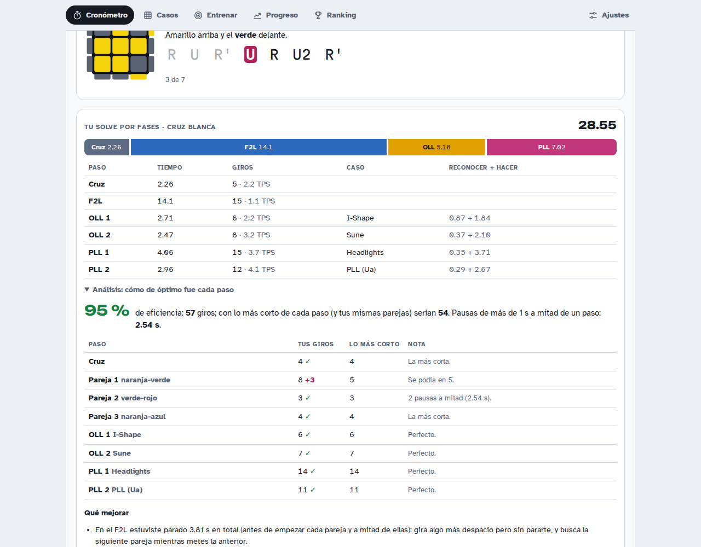

| Sección | Para qué |
|:--|:--|
| **Cronómetro** | Mantén `Espacio` (o el reloj) y suelta para empezar, como en un stackmat, con inspección WCA opcional (+2 y DNF). La **cruz más corta** del scramble (búsqueda completa, unos 6 giros de media). Historial con +2/DNF, ao5, ao12 y ao100, y la **gráfica** de tus tiempos con ao5 y ao12 (últimos 50, 200 o todos). **Modo competición** (`F`): solo el reloj y el scramble, a pantalla completa, con toda la pantalla como botón. |
| **Con el cubo** | Sigue el scramble y empieza con tu primer giro (girar el cubo entero no cuenta); para solo al resolverlo (y el móvil vibra). Saca los **tiempos de cada paso** (cruz, F2L, OLL 1, OLL 2, PLL 1, PLL 2) con sus giros, TPS, el caso que te salió y cuánto tardaste en **reconocerlo** y en **hacerlo**, y te dice en qué paso se te va el tiempo de media. En directo, te dice el caso y el algoritmo, qué cara poner delante y si hay que girar arriba antes o después, y marca por dónde vas; en el F2L, **la pareja más corta** de las que quedan y cómo meterla, y si una pareja es uno de los **41 casos básicos**, cuál es y su algoritmo. «Practicar sin crono» hace lo mismo sin cronometrar. **Ritmo en directo**, como en los speedruns: al acabar la cruz, el F2L, el OLL y el PLL, cuánto vas por delante (verde) o por detrás (rojo) de tu media de los últimos 12 solves (o de tu mejor solve), dorado ★ si ese paso es el más rápido que has hecho nunca, y «Vas para…»; si te pasas del tiempo de referencia en un paso, el retraso cuenta en directo. |
| **Récords** | Al batir tu mejor single, ao5 o ao12: «¡Nuevo récord!» con lo que tenías antes, confeti con los colores del cubo, una fanfarria y vibración (se puede quitar en Ajustes). En el historial, una etiqueta **PB** en cada solve que fue tu mejor single. |
| **Después de cada solve** | El **análisis**: cuántos giros hiciste en cada paso (la cruz, cada pareja, cada algoritmo) contra lo más corto posible, la eficiencia total, las pausas de más de 1 s y qué mejorar primero; y la eficiencia media con los tiempos por fase. La **reconstrucción**: tus giros paso a paso como los hiciste (con el blanco abajo), para copiarla. Las dos también en el historial («ver»). |
| **Casos** | Los 16 casos de la última capa dibujados como en J Perm, con su algoritmo, cómo reconocerlos y si los estás aprendiendo o te los sabes. Y en **F2L**, los **41 casos básicos** del F2L con algoritmo: en sus seis grupos (directas, unidas, separadas, la esquina, la arista o las dos ya en su hueco), dibujados en 3D, con el algoritmo de J Perm y otros, y cómo se reconocen en palabras. **Pruébalo**: con el cubo resuelto, una mezcla que te deja en ese caso (el algoritmo al revés, o una que no lo delata), cómo queda y cómo resolverlo para que vuelva a quedar resuelto. |
| **Dos modos** | Casos y Entrenar van en **modo aprendizaje** (otro color, verde azulado, en la página, el menú y la cabecera); el cronómetro, Progreso y Ranking, en **modo cronómetro**. Cambia solo al cambiar de pestaña, y el overlay de OBS también. |
| **Entrenar** | **Qué entrenar hoy:** con tus solves y tus entrenamientos, dónde puedes ganar tiempo (segundos por solve: pararte en el F2L, giros de más, la cruz, reconocer, algoritmos lentos) y un **set recomendado** de casos con su dibujo, su algoritmo y por qué; Se recalcula sola: al entrar y cada 10 casos entrenados. **«Empezar sesión»** (con el set recomendado, o **«Elegir yo los casos…»**: los 16 de la última capa y los 41 del F2L para marcar, con atajos —los recomendados, los que estás aprendiendo, OLL, PLL, F2L— y el modo) abre una pantalla de entrenamiento, que no deja que el móvil se apague, con un reloj del tiempo entrenando, tus casos de hoy y cada caso del set con su progreso: lo **dominas** con unos cuantos seguidos (con el cubo inteligente, por debajo de su objetivo, tu buen nivel para ese caso; reconociendo, bien y rápido), y entonces sale del set y entra el siguiente que más te cuesta (en una sesión con casos del F2L, el siguiente del F2L que estás aprendiendo o que aún no te sabes) (con los casos que elegiste tú, se queda marcado como dominado, salvo que pidas el cambio); cada 12 intentos lo vuelve a pesar por si otro te cuesta claramente más. **«Cambiar los casos»** durante la sesión: quitas o añades, y los que siguen conservan su cuenta. Si recargas, sigue donde estaba; al terminar, un resumen con cada caso hoy contra antes, guardado en «Tus sesiones». **Cubo inteligente:** te dice cómo dejar tu cubo en un caso (desde como esté, con un scramble que no lo delata), lo resuelves y mide reconocer + hacer; si te lías, «Me he perdido» lo cuenta como fallo y te prepara otro desde como esté el cubo. **El algoritmo a la vista, caso a caso:** cada caso de tu set tiene un **ojo** (arriba a la derecha) y «Ver el algoritmo» en el entrenador es el mismo ojo; si está activado, ese caso sale siempre con su algoritmo a la vista y los demás no cambian. Esos intentos cuentan como práctica, aparte de tus tiempos: en la sesión llevan un ojo y no suman ni rompen la racha, y un aviso te lo recuerda. **Cubo normal:** te da una mezcla desde resuelto, adivinas qué caso te ha quedado y te dice cómo resolverlo (también con «Me he perdido»). **Reconocer:** te enseña un caso desde cualquier lado y dices cuál es (teclas `1`–`9` y `0`; en el F2L, entre los de su grupo). Salen más los que menos has hecho y los más lentos. **La cruz:** un scramble, 15 s para planearla y hacerla de una vez; te dice cuántos giros te sobraron y la más corta. **Tus casos, en números:** los 16 con lo que tardas en tus solves, lo entrenado, los fallos y lo que te cuesta cada uno por solve. |
| **Ranking** | Una liga con tus amigos: solo cuenta el tiempo total, como en una competición (mejor single, media de 5 y media de 12, al estilo WCA). La creas, mandas el enlace (`/fridrich#liga=código`) y cada uno entra con su nombre; no hace falta cubo inteligente. Tus récords se publican solos (y se corrigen si pones un +2 o borras un solve), y al batir uno te dice en qué puesto quedas. Si un amigo bate el suyo, te avisa y lo marca «nuevo». En cada récord, «ver»: con cubo inteligente, cada paso, sus casos y la eficiencia; sin él, el scramble para copiarlo o **probarlo** en tu cronómetro, que te dice al acabar si le has ganado. |
| **Progreso** | Cómo vas, en palabras y en números: mejores single, ao5 y ao12, tu media contra la de antes y la de hace un mes, la semana contra la anterior. Tu media y tu mejor tiempo de cada día, los logros (primera vez por debajo de 40 s…) y el siguiente a por el que ir. Un calendario de lo que practicas y tu racha. Cada paso (cruz, F2L, OLL, PLL) ahora contra antes, la eficiencia de tus solves, la cruz y los casos que más te cuestan. |
| **Ajustes** | Sonido y vibración, inspección, color de la cruz, la ayuda. **Sincronizar** con el mismo código de la página de 3BLD: tiempos, casos y entrenamientos en todos tus dispositivos. **Instalar** como app y aviso de **versión nueva**. |
| **Overlay** | El mismo de OBS: cuando usas esta página, enseña el cronómetro con cruz, F2L, OLL y PLL (y debajo de cada uno, cuánto vas por delante o por detrás de tu media, dorado si es tu mejor), el caso que estás haciendo con su algoritmo, tus medias de hoy y cuántos algoritmos te sabes. Con un récord: «¡Nuevo récord! · Single 21.30» y confeti. Cuando pasas a Casos o Entrenar, cambia solo a una **vista de aprendizaje**: el caso que estás haciendo (su dibujo cuando es para reconocer, sin decir cuál es hasta que respondes; con el cubo inteligente, los giros para dejarlo en el caso sobre el cubo en directo), cómo te ha ido (acertado o no, reconocer + hacer), y la sesión con el progreso de cada caso del set y lo que has dominado. |

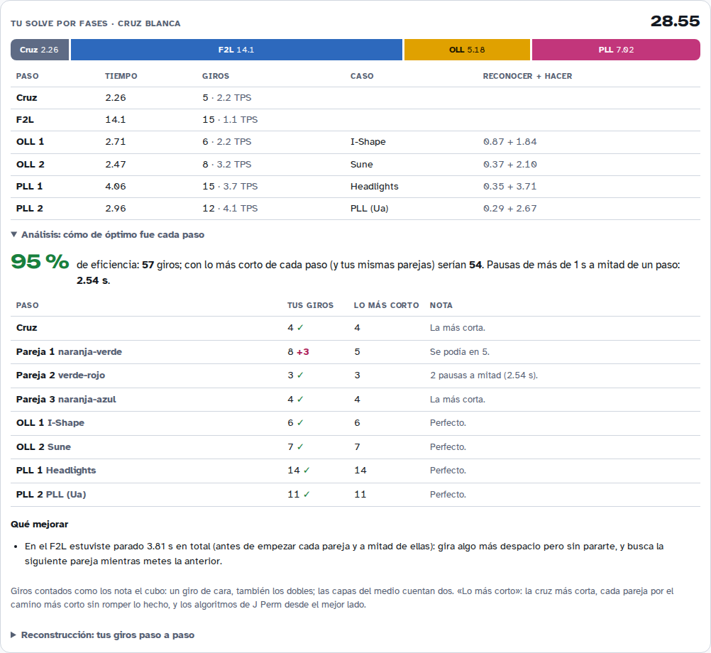

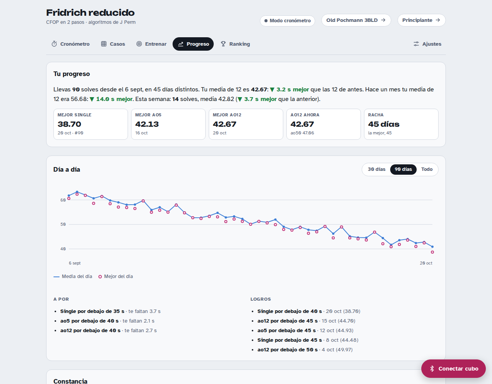

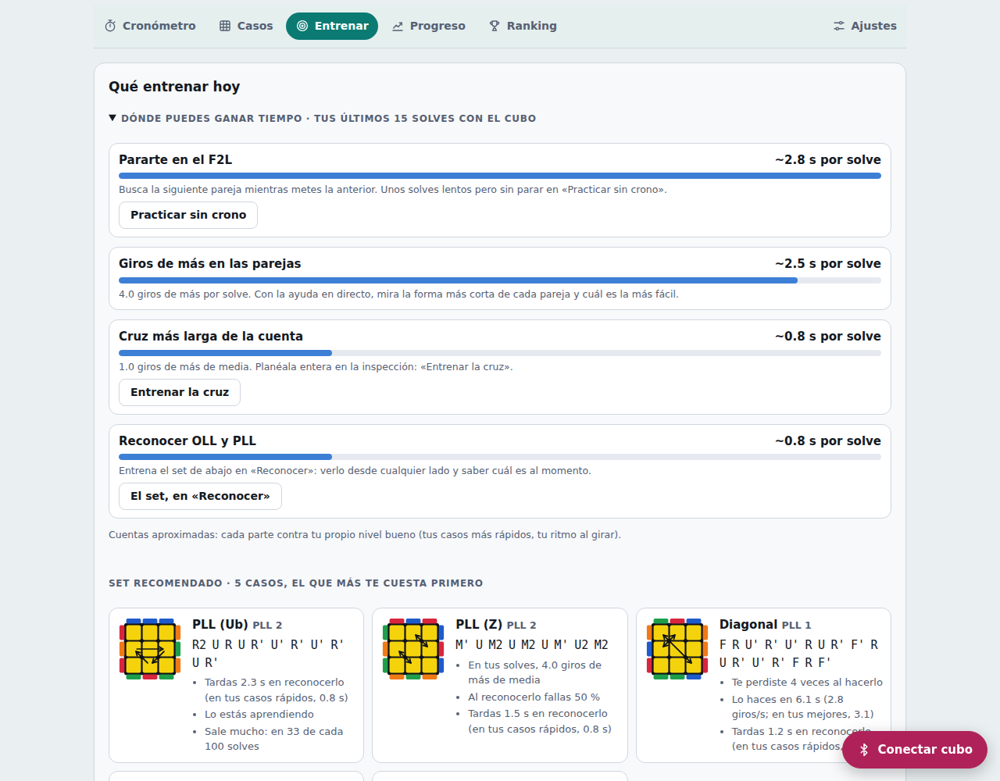

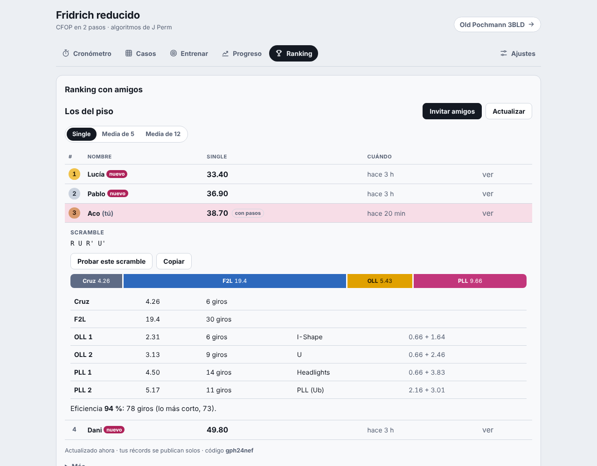

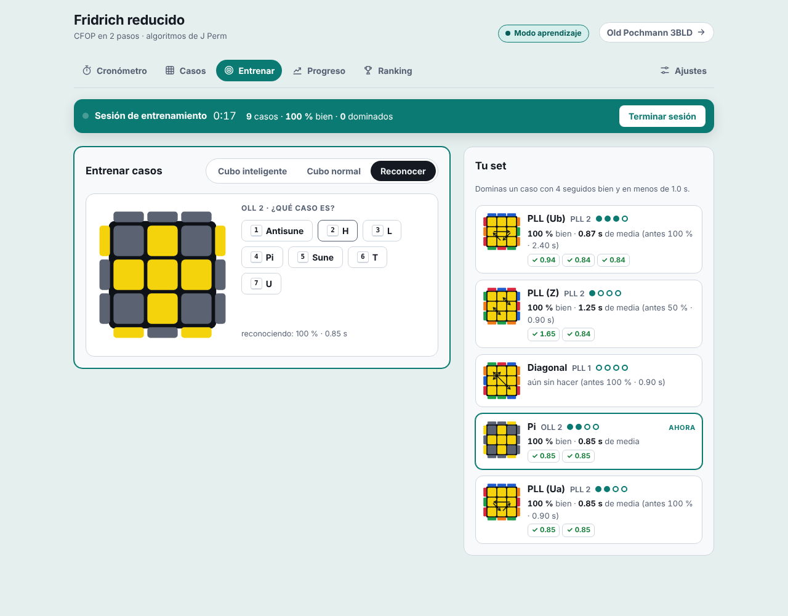

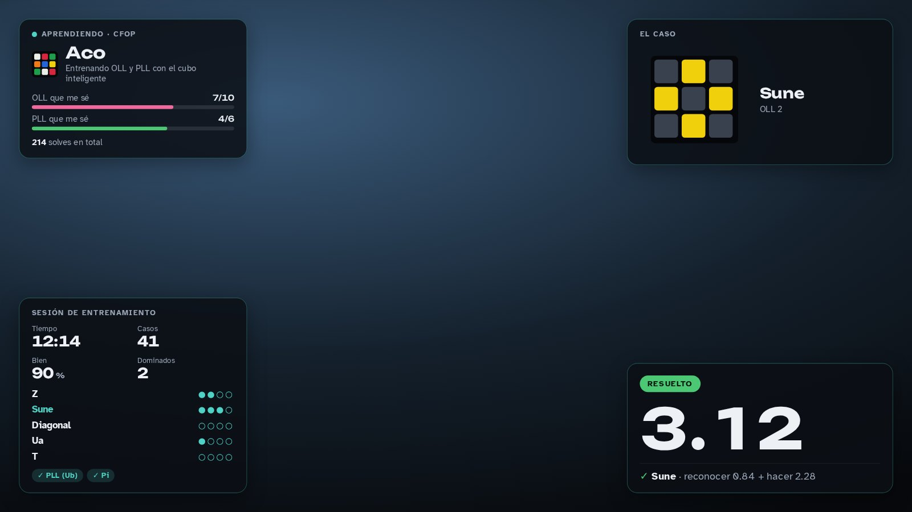

### Los algoritmos

Los de [J Perm](https://jperm.net/3x3/cfop) ([2-look OLL](https://jperm.net/algs/2lookoll), [2-look PLL](https://jperm.net/algs/2lookpll)), tal cual, con amarillo arriba:

| Paso | Caso | Algoritmo |
|:--|:--|:--|
| OLL 1 | Dot Shape | `F R U R' U' F' f R U R' U' f'` |
| | I-Shape | `F R U R' U' F'` |
| | L-Shape | `f R U R' U' f'` |
| OLL 2 | Antisune | `R U2 R' U' R U' R'` |
| | H | `R U R' U R U' R' U R U2 R'` |
| | L | `F R' F' r U R U' r'` |
| | Pi | `R U2 R2 U' R2 U' R2 U2 R` |
| | Sune | `R U R' U R U2 R'` |
| | T | `r U R' U' r' F R F'` |
| | U | `R2 D R' U2 R D' R' U2 R'` |
| PLL 1 | Diagonal | `F R U' R' U' R U R' F' R U R' U' R' F R F'` |
| | Headlights | `R U R' U' R' F R2 U' R' U' R U R' F'` |
| PLL 2 | H | `M2 U M2 U2 M2 U M2` |
| | Ua | `R U' R U R U R U' R' U' R2` |
| | Ub | `R2 U R U R' U' R' U' R' U R'` |
| | Z | `M' U M2 U M2 U M' U2 M2` |

Los **41 casos del F2L** van numerados y agrupados como en [SpeedCubeDB](https://www.speedcubedb.com/a/3x3/F2L). El primer algoritmo de cada uno es el de J Perm (su [«Best F2L Algorithms»](https://bit.ly/bestf2l), la columna del hueco de delante a la derecha); después, los demás suyos y el más votado en SpeedCubeDB. Todos están comprobados contra los setups de SpeedCubeDB (`tests/fixtures/f2l-scdb.json`): cada uno resuelve su caso sin tocar la cruz ni las otras parejas. Los de J Perm que mueven otro hueco (los marca en su hoja) no están.

### Cómo reconoce los casos

- **En qué paso estás.** Para cada color posible abajo, la app gira el cubo para ponerlo ahí y comprueba, en orden, la cruz, las cuatro parejas (esquina + arista de cada hueco), las aristas de arriba orientadas, toda la cara de arriba, las esquinas de arriba en su sitio (salvo un giro de U) y el cubo entero. Se queda con el color más avanzado; si empatan, con el de tus ajustes (blanco).
- **Qué caso es.** Prueba los 4 lados que puedes poner delante, los 4 giros de U de antes y los algoritmos del paso, y se queda con el que lo deja hecho, prefiriendo no girar U antes. En PLL 2 busca también el giro de U del final. Así la indicación es exacta: «amarillo arriba y el rojo delante; antes U'».
- **A mitad de un algoritmo.** Casi todos deshacen la cruz o el F2L un momento. La ayuda sigue todas las formas de hacer el caso (desde cualquier lado, con o sin giro de U antes) y marca por dónde vas; si haces otra cosa, se queda en el paso al que habías llegado hasta que el cubo vuelve (o hasta 40 giros, si de verdad lo has deshecho).
- **Los tiempos de cada paso.** Con los estados del cubo tras cada giro, cada paso acaba la primera vez que se cumple con los anteriores. Como un paso solo cuenta si los anteriores siguen hechos, que un *R U R'* deshaga la cruz un momento no confunde nada. Reconocer es el tiempo hasta el primer giro del paso.
- **La cruz más corta.** Búsqueda en anchura sobre las cuatro aristas de la cruz (190 080 posiciones, se calcula una vez en unos 50 ms); la solución baja por las distancias.
- **Qué caso del F2L es.** Para cada hueco libre, la app gira el cubo para ponerlo delante a la derecha, prueba los 4 giros de arriba y los 41 algoritmos (cada uno precalculado como una permutación: menos de 1 ms en total), y se queda con el que mete esa pareja sin romper nada. Si una de sus piezas está en otro hueco, no es uno de los 41 y no dice nada.
- **La pareja más corta.** IDA* sin giros de D que no rompe la cruz ni las parejas hechas, con dos tablas exactas como cota (la cruz y cada pareja por separado, 576 posiciones por hueco). Unos 4 ms de mediana.
- **Qué entrenar.** Cada caso cuesta, por solve: lo que tardas en reconocerlo de más (contra tus casos más rápidos), en hacerlo de más (contra tus mejores giros por segundo), lo que fallas al reconocerlo y las veces que te pierdes, todo por lo a menudo que sale (Ua y Ub, 1 de cada 3 solves; H de PLL, 1 de cada 12). Los que más cuestan forman el set. Los pasos, igual: segundos parado en el F2L, giros de más por tu ritmo, reconocer de más.
- **El análisis.** Cuenta los giros como los nota el cubo (un giro de cara, también los dobles; las capas del medio cuentan dos; girar el cubo entero no cuenta). Lo más corto de cada paso: la cruz más corta; para cada pareja, la más corta desde cómo estaba el cubo cuando la empezaste (y si había otra pareja más fácil); para OLL y PLL, el algoritmo de J Perm desde el mejor lado, con los giros de U justos. La eficiencia es la suma de lo más corto entre tus giros.

## Aprende a resolver el cubo

En [`/principiante`](https://old-pochmann-3bld.vercel.app/principiante), una tercera página para quien no sabe resolverlo: el **método de principiantes** (capa a capa) en 7 pasos y con 7 algoritmos cortos, todo con dibujos. Más sencilla que las otras (sin ranking ni overlay), pero entera: aprender, resolver con ayuda, entrenar un paso suelto y ver cómo vas. Se instala aparte como app («Principiante») y funciona sin conexión.

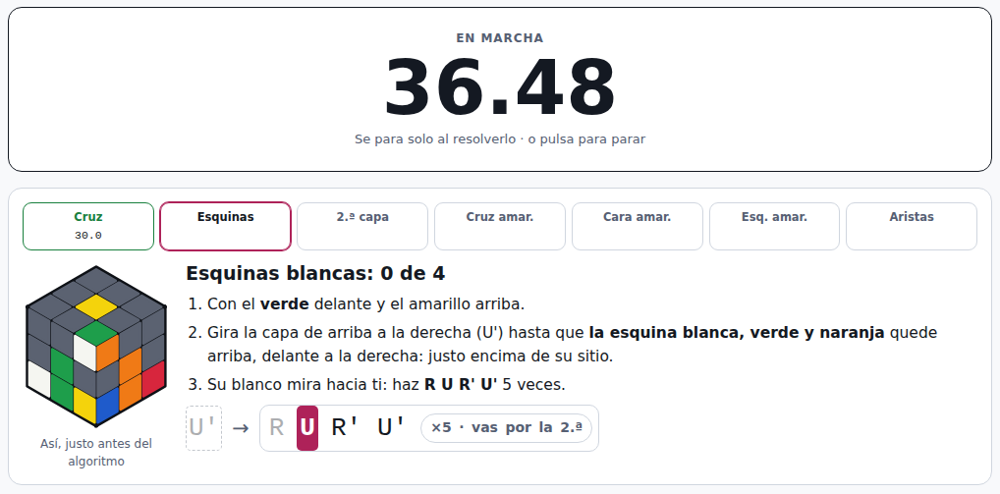

| Sección | Para qué |
|:--|:--|
| **Aprender** | **Antes de empezar:** las piezas (centros, aristas, esquinas), cómo se sujeta (amarillo arriba todo el método), cómo se leen los giros (con un dibujo del cubo después de cada uno) y cómo se mezcla. **Los 7 pasos**, cada uno con su objetivo dibujado, cómo se hace, su algoritmo, cada caso dibujado y un consejo. «Ya me lo sé» marca el paso (y el camino de arriba enseña el siguiente); «Practicar este paso» lo abre en Entrenar. |
| **Resolver** | Una mezcla y el cronómetro (`Espacio` o el reloj). **Con el cubo inteligente:** sigue la mezcla giro a giro, empieza con tu primer giro y para al resolverlo; la **ayuda en directo** te dice en cada momento qué hacer, en palabras («gira el cubo entero para tener el rojo delante», «su blanco mira hacia arriba: haz R U R' U' 3 veces»), con un dibujo de cómo tiene que quedar el cubo antes de empezar y los giros, marcando por cuál vas (y cuántas veces llevas de un algoritmo que se repite). Si a mitad de un algoritmo se deshace lo de abajo, espera; si haces otra cosa, se pone al día. **Contra el reloj**, sin ayuda. Al acabar, el tiempo y los giros de cada paso. **Sin cubo inteligente:** «¿Te has atascado?» enseña la solución entera de la mezcla con el método, paso a paso y con dibujos. |
| **Entrenar** | Un paso suelto, con el cubo justo al empezarlo, como sale en una resolución de verdad. **Con el cubo inteligente:** te dice cómo dejarlo ahí desde como esté, sigue cada giro, mide cuánto tardas y cuántos giros haces (contra los del método) y prepara otro; «Con ayuda» enseña qué hacer y «Me he perdido» cuenta un fallo y trae otro. **Con un cubo normal:** una mezcla desde resuelto, el dibujo de cómo tiene que quedar y cómo se hace el paso desde ahí. |
| **Progreso** | Resueltos, mejor tiempo, medias de 5 y de 12, tus tiempos en una gráfica, cada paso (si te lo sabes, lo entrenado y cuánto tardas en tus resoluciones: dónde se te va el tiempo, con un botón para entrenarlo) y metas (el primer cubo, uno sin ayuda, bajar de 3, 2 y 1 minuto…). |
| **Ajustes** | Sonido, vibración y tema. **Sincronizar** con el mismo código que las otras páginas, y tus datos. |

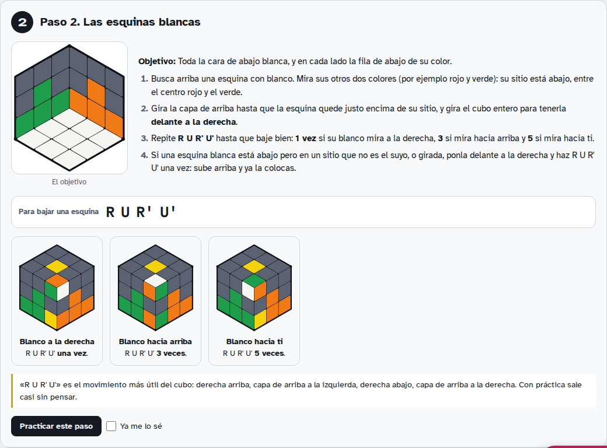

### Los 7 pasos

Todo con el amarillo arriba y el blanco abajo.

| Paso | Cómo | Algoritmo |
|:--|:--|:--|
| 1. La cruz blanca | La margarita (las 4 aristas blancas alrededor del centro amarillo) y bajarlas una a una cuando coinciden con su centro | `F2` |
| 2. Las esquinas blancas | Cada esquina encima de su sitio, delante a la derecha: 1, 3 o 5 veces según adónde mire el blanco | `R U R' U'` |
| 3. La segunda capa | La arista forma una T con su centro y va a la derecha o a la izquierda | `U R U' R' U' F' U F` · `U' L' U L U F U' F'` |
| 4. La cruz amarilla | Punto → L → línea → cruz (la L detrás a la izquierda, la línea de lado) | `F R U R' U' F'` |
| 5. La cara amarilla | Una esquina amarilla: delante a la izquierda; ninguna: la de delante a la izquierda con el amarillo a la izquierda; dos: con el amarillo hacia ti (como mucho 3 veces) | `R U R' U R U2 R'` |
| 6. Las esquinas amarillas | Los faros (las dos esquinas de un lado iguales) detrás; si no hay, una vez desde cualquier lado | `R' F R' B2 R F' R' B2 R2` |
| 7. Las aristas amarillas | El lado entero detrás (una o dos veces); si no hay, una vez desde cualquier lado | `R U' R U R U R U' R' U' R2` |

### Cómo sabe qué toca

`lbl.js` lee el cubo con el blanco abajo (la cruz, las esquinas, las aristas del medio, la cruz y la cara amarillas, las esquinas y las aristas de arriba en su sitio) y, desde cualquier estado, calcula lo siguiente que haría alguien que aprende el método: en la cruz, los giros más cortos que suben otra arista a la margarita sin tirar las que ya hay (búsqueda en profundidad, unos milisegundos) o qué pétalo bajar; en los demás pasos, prueba los 4 lados que puedes poner delante y los giros de arriba, y se queda con el que cumple la regla del método con menos giros, comprobando que no deshace nada. Cada plan lleva sus giros exactos, así que la ayuda sigue tu cubo giro a giro (también las medias vueltas). Las pruebas resuelven 300 cubos al azar así, sin volver nunca atrás un paso, en unos 145 giros de media.

## El método

- **Orientación:** blanco arriba, verde delante. Letras **Speffz**.
- **Aristas:** buffer **B** (UR), se intercambia con **D** (UL) usando la **T-perm**.
- **Esquinas:** buffer **A** (UBL; la pegatina que lees es la **E**), se intercambia con **V** (DFR) usando la **Y-perm modificada**.
- **Paridad:** con un número impar de aristas, una **R-perm** justo al acabar las aristas y antes de las esquinas.

| Algoritmo | Movimientos | Uso |
|:--|:--|:--|
| T-perm | `R U R' U' R' F R2 U' R' U' R U R' F'` | Aristas: B ↔ D (y de paso UFR ↔ UBR) |
| Y-perm modificada | `R U' R' U' R U R' F' R U R' U' R' F R` | Esquinas: E ↔ V (y de paso UL ↔ UB) |
| R-perm | `R U R' F' R U2 R' U2 R' F R U R U2 R' U'` | Paridad |

<details>
<summary><b>Setups de aristas</b> (lleva la letra a D sin tocar el buffer)</summary>

| Letra | Pegatina | Setup | | Letra | Pegatina | Setup |
|:-:|:-:|:--|-|:-:|:-:|:--|
| **A** | UB (U) | `l2 D' l2` | | **N** | BR (R) | `d L` |
| **C** | UF (U) | `l2 D l2` | | **O** | DR (R) | `D' l D L2` |
| **D** | UL (U) | — | | **P** | FR (R) | `d' L'` |
| **E** | UL (L) | `L d' L` | | **Q** | UB (B) | `l' D L2` |
| **F** | FL (L) | `d' L` | | **R** | BL (B) | `L` |
| **G** | DL (L) | `L' d' L` | | **S** | DB (B) | `l' D' L2` |
| **H** | BL (L) | `d L'` | | **T** | BR (B) | `d2 L'` |
| **I** | UF (F) | `l D' L2` | | **U** | DF (D) | `D' L2` |
| **J** | FR (F) | `d2 L` | | **V** | DR (D) | `D2 L2` |
| **K** | DF (F) | `l D L2` | | **W** | DB (D) | `D L2` |
| **L** | FL (F) | `L'` | | **X** | DL (D) | `L2` |

</details>

<details>
<summary><b>Setups de esquinas</b> (lleva la letra a V sin tocar el buffer)</summary>

| Letra | Pegatina | Setup | | Letra | Pegatina | Setup |
|:-:|:-:|:--|-|:-:|:-:|:--|
| **B** | UBR (U) | `R2` | | **N** | UBR (R) | `R' F` |
| **C** | UFR (U) | `F2 D` | | **O** | DBR (R) | `R2 F` |
| **D** | UFL (U) | `F2` | | **P** | DFR (R) | `R F` |
| **F** | UFL (L) | `F' D` | | **Q** | UBR (B) | `R D'` |
| **G** | DFL (L) | `F'` | | **S** | DBL (B) | `D F'` |
| **H** | DBL (L) | `D' R` | | **T** | DBR (B) | `R` |
| **I** | UFL (F) | `F R'` | | **U** | DFL (D) | `D` |
| **J** | UFR (F) | `R'` | | **V** | DFR (D) | — |
| **K** | DFR (F) | `F' R'` | | **W** | DBR (D) | `D'` |
| **L** | DFL (F) | `F2 R'` | | **X** | DBL (D) | `D2` |
| **M** | UFR (R) | `F` | | | | |

</details>

Cada letra se resuelve como **setup → algoritmo → deshacer el setup**. Cualquier otro setup que haga lo mismo también vale en Entrenar.

## Atajos de teclado

| Dónde | Tecla | Hace |
|:--|:--|:--|
| Practicar y Tabla | `1` · `2` | Aristas · esquinas |
| | `A`–`X` | Ver esa letra en el cubo |
| | `←` `→` · `Espacio` | Paso a paso del setup |
| | `↑` `↓` | Letra anterior o siguiente del memo |
| Ejecución guiada | `Espacio` o `→` · `←` · `Esc` | Siguiente · atrás · salir |
| Cronómetro | `Espacio` | Empezar el memo → ejecución → parar |
| | `Esc` | Cancelar el intento (o salir del modo competición) |
| | `F` | Modo competición |
| Entrenar | `Intro` · `?` | Comprobar · spoiler del cubo |
| Aprender | `←` `→` | Lección anterior o siguiente |
| Fridrich · Cronómetro | `Espacio` | Mantén y suelta para empezar (o la inspección); pulsa para parar |
| | `Esc` | Cancelar (o salir del modo competición) |
| | `F` | Modo competición |
| Fridrich · Entrenar | `1`–`7` · `Intro` | Responder en «Reconocer» · siguiente |

## Arquitectura

JavaScript, HTML y CSS sin frameworks ni empaquetador: lo que hay en el repo es lo que se sirve (versionado y sin minificar). En el servidor, unas pocas funciones de Vercel con Redis (Upstash) o Vercel Blob como almacenamiento.

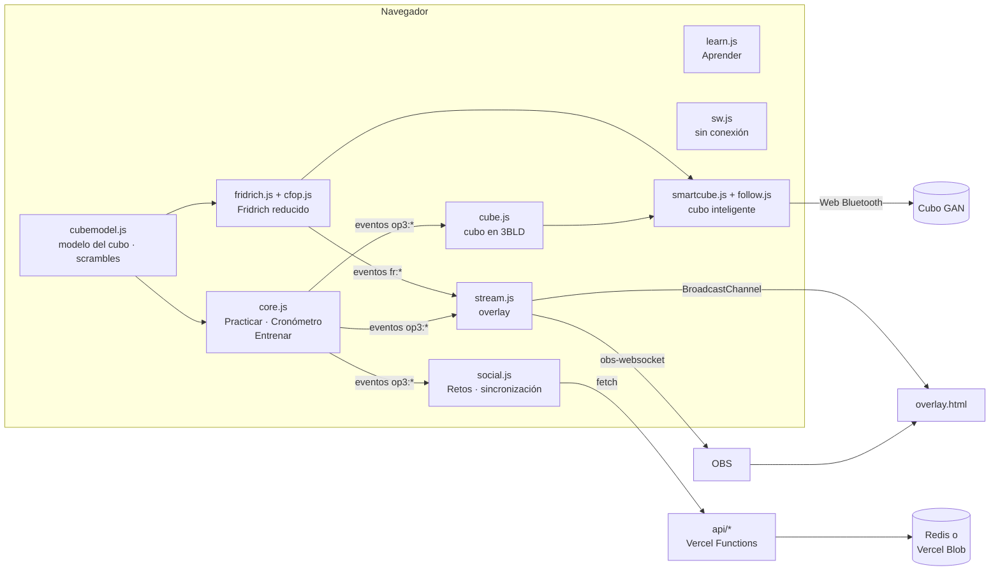

| Archivo | Qué hace |
|:--|:--|
| `index.html` | La app de 3BLD: todas las vistas, marcadas con `data-view`, y los diálogos. |
| `app.css` | Los estilos, con colores como variables para el tema claro y el oscuro (también los usa Fridrich). |
| `cubemodel.js` | El modelo del cubo, compartido por las dos páginas: permutación de 54 pegatinas con giros de cara, anchos, de capa y rotaciones, el marco del cubo inteligente (centros fijos) y el generador de scrambles de estado aleatorio (Web Worker con cubejs). Expone `window.CubeModel`. |
| `core.js` | El método, Practicar, la ejecución guiada, el Cronómetro, el modo competición y Entrenar. Expone `window.OP3`. |
| `learn.js` | Las 9 lecciones interactivas de Aprender. |
| `syncplan.js` | Cuándo sincroniza cada página por su cuenta (lo usan las dos). Expone `window.SyncPlan`. |
| `social.js` | Retos, compartir como imagen y la sincronización entre dispositivos. |
| `stream.js` | El overlay: genera el estado y lo manda por obs-websocket y BroadcastChannel. |
| `cube.js` | El cubo inteligente en la página de 3BLD, sobre `smartcube.js`: seguimiento, intentos, análisis de DNF, Entrenar y guía con el cubo, y los atajos del cubo virtual. |
| `principiante.html` · `principiante.css` · `principiante.js` | La página del método de principiantes (`/principiante`): Aprender con dibujos, Resolver con ayuda en directo, Entrenar un paso, Progreso y ajustes. |
| `lbl.js` | El método de principiantes sin pantalla: en qué paso está un cubo y qué hacer después, desde cualquier estado, con sus giros exactos. Expone `window.Lbl`. |
| `fridrich.html` · `fridrich.css` · `fridrich.js` | La página de Fridrich reducido (`/fridrich`): cronómetro, ayuda en directo, tiempos por fase, Casos, Entrenar y ajustes. |
| `fridrich-progreso.js` · `fridrich-cruz.js` · `fridrich-sync.js` | Partes de `fridrich.js` en su propio archivo: Progreso, Entrenar la cruz y la sincronización. Cada una expone `window.Fridrich…(ctx)`, que `fridrich.js` llama con lo que necesita. |
| `practice.js` | El tiempo real practicando en Fridrich (entre una acción y la siguiente, si no pasan 2 minutos), por día y por dispositivo. Expone `window.Practice`. |
| `cfop.js` | El método CFOP sin pantalla: los 16 algoritmos de J Perm, en qué paso está un cubo, qué caso es, la cruz más corta y los tiempos de un solve. Expone `window.Cfop`. |
| `cfopf2l.js` | Los 41 casos del F2L sin pantalla: sus algoritmos, qué caso enseña cada hueco libre, su dibujo y cómo se ven en palabras. Hace que `Cfop.caseById` los conozca también (la sincronización, el entrenador). |
| `cfopstats.js` | Los números de Fridrich, sin pantalla: medias, mejores marcas, días, racha, logros, cada paso, eficiencia, cada caso y el set recomendado. Expone `window.CfopStats`. |
| `smartcube.js` | El cubo inteligente de las tres páginas: conexión GAN, la MAC, el cubo virtual, el sonido, los giros perdidos, el reloj del cubo y prestar la conexión a otra sección (un iframe encima) para que no se corte. Expone `window.SmartCube`. |
| `follow.js` | Seguir una secuencia con el cubo (scramble, setup): dónde va, mitades de giros y giros opuestos en cualquier orden, qué deshacer. Expone `window.CubeFollow`. |
| `overlay.html` | El overlay para OBS, una página independiente. |
| `sw.js` | El service worker: guarda la app para usarla sin conexión. |
| `build.js` | Genera `public/`: copia los archivos con un hash en la URL, dibuja los iconos PNG y anota el número de versión. |
| `api/` | Funciones de Vercel: retos, sincronización, ligas de amigos (la lógica, en `_reto.js`, `_sync.js` y `_liga.js` sobre el almacén de `_kv.js`, la usan también las pruebas), imágenes de vista previa y enlaces cortos. |
| `vendor/` | gan-web-bluetooth empaquetado ([cómo se genera](vendor/README.md)). |
| `tests/` | Pruebas en navegador y auditorías de accesibilidad ([cómo se ejecutan](tests/README.md)). |
| `docs/img/` | Las capturas de este README (se regeneran con `npm run shots` o con la Action «Capturas»). |

### Módulos y eventos

`core.js` carga primero y publica `window.OP3`: el modelo del cubo (`apply`, `parseAlg`, `solved`, `isSolved`…), el método (`MODES`, `ALGS`, `tokenAlg`…), el control del reloj (`OP3.clock`), el del entrenador (`OP3.trainer`), el del visor de Practicar (`OP3.practice`) y el de la guía (`OP3.guideApi`). Los demás módulos se enganchan a él y se avisan con eventos del documento:

| Evento | Cuándo |
|:--|:--|
| `op3:timer` | Cambia la fase del reloj: `idle`, `memo`, `exec` o `done` (con los tiempos en milisegundos desde 1970, para que otra ventana pueda seguir contando). |
| `op3:result` | Se guarda un intento. |
| `op3:scramble` · `op3:memo` | Cambia el scramble · cambia el memo de Practicar. |
| `op3:changed` | Cambian datos que se sincronizan (intentos, entrenamiento…). |
| `op3:train` · `op3:guide` | Nueva letra en Entrenar · se abre o cambia la ejecución guiada. |
| `op3:cube` | El cubo inteligente se ha movido o cambia de estado (para el overlay). |

En Fridrich, `fridrich.js` publica `window.Fridrich` y avisa con `fr:timer` (fases `idle`, `inspect`, `run`, `done`), `fr:result`, `fr:scramble` y `fr:cube`; `stream.js` manda lo de la página que estés usando.

### Datos en el navegador

Todo se guarda en `localStorage`, en tu dispositivo:

| Clave | Qué guarda |
|:--|:--|
| `op3bld:v1` | Practicar: scramble, memo, letra y vista |
| `op3bld:times:v1` · `op3bld:deleted:v1` | Intentos (los últimos 500) · los borrados, para que la sincronización no los resucite |
| `op3bld:trainer:v1` | Entrenar: por letra, vistas, aciertos, racha, peso y fallos en intentos |
| `op3bld:learn:v1` | Lecciones completadas |
| `op3bld:retos:v1` · `op3bld:retos-gone:v1` · `op3bld:dev:v1` | Retos guardados · retos quitados · identificador anónimo del dispositivo |
| `op3bld:name:v1` · `op3bld:theme:v1` · `op3bld:view:v1` | Tu nombre · tema · última vista |
| `op3bld:sync:v1` | Código de sincronización |
| `op3bld:stream:v1` · `op3bld:overlay:last` | Ajustes del overlay · último estado recibido por el overlay |
| `op3bld:cube-mac:v1` · `op3bld:cube-fx:v1` · `op3bld:train-cube:v1` | MAC de cada cubo (la usan las dos páginas) · sonido y vibración · responder escribiendo o con el cubo |
| `cfop:times:v1` | Fridrich: solves (los últimos 2000) con penalización, scramble y, con el cubo, cada paso `[tiempo, giros, reconocer, caso, salto]`, la reconstrucción y el análisis (de los últimos 500) |
| `cfop:learn:v1` · `cfop:learn-at:v1` · `cfop:train:v1` · `cfop:pick:v1` | Fridrich: casos que aprendes o te sabes · cuándo cambió cada uno (para sincronizar) · lo entrenado por caso · los casos elegidos |
| `cfop:crosstr:v1` · `cfop:deleted:v1` · `cfop:synced:v1` | Fridrich: cruces entrenadas · solves borrados (para que no vuelvan al sincronizar) · última sincronización |
| `cfop:player:v1` · `cfop:ligas:v1` | Ranking: tu identificador y su token (los mismos en todos tus dispositivos) · tus ligas |
| `cfop:liga-pub:v1` · `cfop:liga-seen:v1` | Ranking: lo último que publicaste en cada liga · lo que viste de los demás (para avisarte de sus récords) |
| `cfop:session:v1` · `cfop:sessions:v1` | Fridrich: la sesión de entrenamiento en curso (para seguir tras recargar) · las terminadas, con su resumen (las últimas 200) |
| `cfop:trlog:v1` | Fridrich: cada caso entrenado (los últimos 5000): cuándo, cuál, cómo, si salió bien, sus tiempos y si te perdiste |
| `cfop:settings:v1` · `cfop:scramble:v1` · `cfop:view:v1` | Fridrich: inspección, ayuda, sonido, color de la cruz… · scramble actual · última vista |
| `lbl:times:v1` · `lbl:deleted:v1` | Principiante: tiempos (los últimos 2000) con el tiempo y los giros de cada paso, y si fue con ayuda · los borrados |
| `lbl:known:v1` · `lbl:train:v1` | Principiante: los pasos que te sabes (y cuándo cambió cada uno) · lo entrenado por paso: veces, tiempos sin ayuda, giros y fallos |
| `lbl:settings:v1` · `lbl:scramble:v1` · `lbl:view:v1` · `lbl:synced:v1` | Principiante: sonido, ayuda, el paso que entrenas… · mezcla actual · última vista · última sincronización |

### Sin conexión y versiones

`build.js` añade a cada archivo un hash de su contenido (`core.js?v=1a2b3c4d5e`) y calcula un número de versión del conjunto, que escribe en las tres páginas y en el nombre de la caché del service worker (`op3bld-<versión>`). El service worker guarda las tres páginas al instalarse y las sirve aunque no haya red; cada página la pide a la red primero y usa la caché como plan B. `vercel.json` sirve `/fridrich` desde `fridrich.html` y `/principiante` desde `principiante.html`. Cuando se despliega una versión nueva, el service worker nuevo borra la caché vieja, la página ve que la suya ya no existe y ofrece recargar, nunca durante un intento.

## API

Funciones de Vercel (`api/`). La lógica de retos, sincronización y ligas está en `_reto.js`, `_sync.js` y `_liga.js`, sobre un almacén pequeño (`_kv.js`: documentos y mapas de documentos, sin listar nunca) que puede ser:

- **Redis** de [Upstash](https://upstash.com) (lo crea el Marketplace de Vercel, con `KV_REST_API_URL` y `KV_REST_API_TOKEN`). Si el proyecto lo tiene, se usa este. El plan gratis da 500 000 comandos al mes, y cada petición de la app gasta uno o dos.
- **[Vercel Blob](https://vercel.com/docs/vercel-blob)** (`BLOB_READ_WRITE_TOKEN`): un archivo por clave, que se sobrescribe y se lee por su nombre. Guardar es una «operación avanzada» (el plan gratis da 2 000 al mes) y leer, una «simple» (10 000). Los mapas se cambian con escritura condicional (ETag), así que dos amigos escribiendo a la vez no se pisan.
- **Memoria**, en las pruebas.

Todas responden JSON sin caché, salvo las imágenes. Si el almacén está en pausa (el plan gratis de Blob se pasó del límite), responden 503 y la app lo dice.

| Ruta | Método | Qué hace |
|:--|:--|:--|
| `/api/ping` | GET | Dice si hay almacén, cuál (`kind`) y cada cuánto puede sincronizar la app por su cuenta (`every`, en segundos: 60 con Redis, 600 con Blob). Con `?deep=1` escribe, lee y borra una prueba. |
| `/api/reto` | POST | Crea un reto `{ scramble, by, kind }` y devuelve `{ id }` (8 caracteres). |
| `/api/reto?id=` | GET | El reto con sus resultados (uno por dispositivo: cuenta el primero). |
| `/api/reto?id=` | POST | Añade un resultado `{ name, dev, memo, exec, ok }`. Máximo 150 por reto. |
| `/api/sync?k=` | GET · POST | Lee o guarda los datos sincronizados (un documento por código, hasta 500 KB). |
| `/api/liga` | POST | Crea una liga `{ action: 'create', name, player, best }` y la devuelve con su código (8 caracteres). |
| `/api/liga?code=` | GET | La liga y lo mejor de cada uno: single, ao5 y ao12 con sus solves (scramble, y los pasos si fue con cubo inteligente). |
| `/api/liga?code=` | POST | `join`, `post` (tus mejores, que se comprueban: la media tiene que salir de sus solves) o `leave`. Cada uno escribe solo lo suyo, con un token secreto que el servidor guarda cifrado. Hasta 60 por liga. Cada `post` lleva el nombre de la liga: si el almacén la ha perdido (uno nuevo, por ejemplo), el primero que publica la recupera. |
| `/api/og` | GET | Imagen de vista previa de 1200×630 (`?reto=` para la de un reto). |
| `/r/:id` | GET | Enlace corto de un reto. Los bots de vista previa reciben una página con título, descripción e imagen; las personas van directas a la app. |

En el almacén: `sync/<clave>` (un documento), `reto/<id>` (un mapa: `.` es el reto y `d:<dispositivo>` cada resultado) y `liga/<código>` (`.` es la liga y `m:<jugador>` cada miembro). En Blob son `v2/<clave>.json`; en Redis, `op3:<clave>`.

**Cada cuánto sincroniza la app** (`syncplan.js`, igual en las dos páginas): un cambio no se guarda al momento, espera al siguiente turno (como pronto 20 s después, para juntar varios; como mucho, uno cada `every`) o a que salgas de la página. Abrirla o volver a ella solo lee, y guarda solo si queda algo pendiente. «Sincronizar ahora» lee y guarda siempre. El ranking se actualiza cada 30 s mientras lo miras (cada 5 min con Blob) y al volver a la página.

## Privacidad

- Sin cuentas, sin anuncios, sin analítica y sin cookies. Las tipografías se cargan de Google Fonts.
- Tus intentos, memos y estadísticas se quedan en tu dispositivo.
- **Retos:** se guarda el scramble, tu nombre y tus tiempos, más un identificador aleatorio del dispositivo (para que cuente un resultado por persona).
- **Sincronización:** el servidor recibe tus datos con una clave que es el SHA-256 de tu código; el código nunca sale de tus dispositivos.
- **Cubo inteligente:** la conexión es directa entre el navegador y el cubo. La MAC se guarda solo en tu dispositivo.

## Desarrollo

Hace falta Node 18 o superior. No hay que instalar nada para la app en sí.

```sh
node build.js                    # genera public/
cd tests && npm install
node server.js                   # sirve public/ con una API falsa en http://localhost:8793
npm test                         # todas las pruebas (unas 600 comprobaciones)
```

`tests/server.js` usa la lógica de verdad de la API sobre el almacén en memoria, así que retos, sincronización y ligas funcionan en local sin Vercel. Con `vercel dev` se prueba la API de verdad.

**Despliegue.** Cada push a `main` se despliega solo en Vercel, y llega a producción cuando la GitHub Action «Pruebas» sale en verde (su trabajo «Todo bien» es el Deployment Check del proyecto). Vercel instala `package.json` (`@vercel/blob`, `@vercel/og`, `cubejs`), ejecuta `node build.js` y publica `public/` y `api/`. Hace falta un almacén conectado al proyecto: Redis de Upstash desde el Marketplace (Storage → Upstash for Redis, plan gratis, con el prefijo de variables por defecto, `KV_`) o Vercel Blob; sin ninguno, la app funciona igual pero sin retos, sincronización ni ranking. `vercel.json` sirve `cubejs` desde jsDelivr en el mismo dominio (para el generador sin conexión), traduce `/r/:id` a `/api/r`, sirve `/fridrich` y `/principiante` desde sus páginas y fija las cabeceras de caché de `sw.js` y `vendor/`.

**Pruebas.** Veintiuna suites en Chromium con Playwright (unas 600 comprobaciones) y cinco auditorías con axe-core. La GitHub Action «Pruebas» las pasa en cada push, repartidas en 4 partes a la vez, y «Capturas» rehace las de este README cuando se lanza a mano; ver [tests/README.md](tests/README.md).

## Créditos y licencias

- [cubejs](https://github.com/ldez/cubejs) (MIT): el algoritmo de dos fases de Kociemba para los scrambles y la imagen de vista previa.
- [gan-web-bluetooth](https://github.com/afedotov/gan-web-bluetooth) (MIT) de Andy Fedotov, con [rxjs](https://rxjs.dev) (Apache-2.0) y [aes-js](https://github.com/ricmoo/aes-js) (MIT): la conexión con los cubos GAN. Licencias completas en [`vendor/THIRD_PARTY_LICENSES.txt`](vendor/THIRD_PARTY_LICENSES.txt).
- [@vercel/og](https://github.com/vercel/og-image) (MPL-2.0) y [@vercel/blob](https://github.com/vercel/storage) (Apache-2.0), en el servidor.
- Tipografías [Unbounded](https://fonts.google.com/specimen/Unbounded), [Atkinson Hyperlegible](https://fonts.google.com/specimen/Atkinson+Hyperlegible) y [Martian Mono](https://fonts.google.com/specimen/Martian+Mono) (SIL Open Font License).
- Algoritmos de [J Perm](https://jperm.net) (OLL y PLL en dos pasos, y los del F2L) y numeración y grupos del F2L de [SpeedCubeDB](https://www.speedcubedb.com).
- Método Old Pochmann, de Stefan Pochmann. Letras Speffz.

Hecho por Acoidan Martín Conrado.
